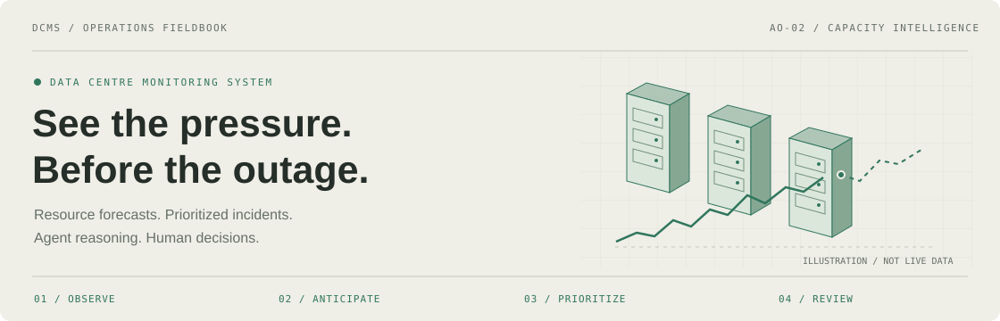
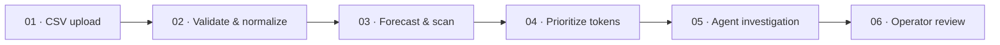

<div align="center">



**[ENTER THE CONTROL ROOM ↗](https://dcms18.vercel.app/)** &nbsp; · &nbsp; [Follow an incident](#02--follow-one-reading) &nbsp; · &nbsp; [Start locally](#05--bring-the-control-room-online)

<sub>REACT + TYPESCRIPT &nbsp; / &nbsp; FASTAPI + NUMPY &nbsp; / &nbsp; LANGGRAPH &nbsp; / &nbsp; GEMINI · OPENAI</sub>

</div>

---

## 01 / One facility. Four perspectives.

**DCMS — Data Centre Monitoring System** connects telemetry, capacity forecasting, and agent-assisted incident review. Upload readings, find the resources under pressure, and give the operator an ordered path to a decision.

| View | The question it answers | Inside the frame |
|:---|:---|:---|
| **Facility** | Where is the pressure? | Isometric rack map and resource health. |
| **Queue** | What needs attention first? | Incident tokens ordered by urgency and resource impact. |
| **Forecast** | What is the trend telling us? | CSV upload, historical readings, projections and uncertainty. |
| **Operator** | What should we do next? | Agent progress, recommendations, approval gates and decision history. |

The system monitors power, thermal/cooling, storage, network, virtual-machine compute, and software-license resources. REST APIs supply dashboard data; WebSockets stream queue and agent transitions.

## 02 / Follow one reading



**The signal.** Uploading a CSV triggers a resource scan and queues incidents that need attention. NumPy-based linear regression estimates capacity trends, confidence and lead time. These calculations are separate from the language-model recommendations.

**The order.** Priority numbers range from **1–100; lower numbers run first**. Capacity utilization, resource criticality and reliable forecast urgency determine the order. Power and cooling risks receive special urgency near capacity.

**The reasoning.** LangGraph coordinates monitoring, root-cause analysis, remediation planning and risk assessment, with Gemini and OpenAI provider support. A deterministic mock provider supports demonstrations without API keys.

**The decision.** Operators review recommendations and handle human-approval gates where required. The decision trail records the incident's progression through the workflow.

> **Operating boundary** · DCMS provides read-only decision support. Recommendations inform the operator; infrastructure changes are not executed by the application.

## 03 / Your data, into the workflow

Open **Forecast → Custom telemetry → Upload & scan CSV**. An [example file](frontend/public/telemetry-example.csv) is included.

- Supports familiar heading aliases such as `Timestamp` / `Time`, `Rack ID` / `Server`, `Tenant` / `Customer`, and `Resource` / `Metric`.
- Accepts resource/value rows or separate resource columns; recognized units are normalized.
- Storage in TB/GB or binary equivalents requires total capacity in the CSV or the optional capacity input.
- Use valid timestamps and supported facility/rack and tenant identifiers. Invalid or ambiguous data returns validation feedback.
- Uploads are limited to **10 MB**. Forecasting requires at least **10 readings per series**.

Supplied series replace their current readings for the backend session. Heading recognition uses supported aliases, rather than unrestricted interpretation of arbitrary column names.

## 04 / Under the floor tiles

| Layer | Stack |
|---|---|
| Interface | React 18, TypeScript, Vite 5, Tailwind CSS, native SVG |
| API | Python, FastAPI, Uvicorn, Pydantic |
| Forecasting & ingestion | NumPy, Python CSV library |
| Agent orchestration | LangGraph, LangChain Core, Google GenAI SDK, OpenAI SDK |
| State & updates | React Context/hooks, in-memory backend state, REST, WebSockets |
| Verification | Pytest/unittest, FastAPI TestClient, TypeScript/Vite build |

## 05 / Bring the control room online

Use **Python 3.11** and **Node.js 18+** with npm for the pinned dependencies. Run the following PowerShell commands from the repository root. Create a fresh virtual environment on each machine; virtual environments are not portable.

**1. Prepare the backend**

```powershell
py -3.11 -m venv .venv
.\.venv\Scripts\python.exe -m pip install -r backend\requirements.txt
Copy-Item backend\.env.example backend\.env
```

In `backend/.env`, set `LLM_PROVIDER=mock` for a demonstration without keys. For live model responses, choose `gemini` or `openai` and supply the corresponding `GEMINI_API_KEY` or `OPENAI_API_KEY`. Model settings are configurable in that file. Keep credentials out of version control.

**2. Start the backend**

```powershell
cd backend
..\.venv\Scripts\python.exe -m uvicorn app.main:app --host 127.0.0.1 --port 8017
```

**3. Start the frontend in a second terminal**

```powershell
cd frontend
npm ci
$env:VITE_API_BASE="http://127.0.0.1:8017"
npm run dev -- --host 127.0.0.1 --port 5175 --strictPort
```

Open **http://127.0.0.1:5175**. Backend health: **http://127.0.0.1:8017/health** · API documentation: **http://127.0.0.1:8017/docs**.

For a hosted frontend, set `VITE_API_BASE` to the reachable backend URL **before building**. The backend must be deployed separately with WebSocket support; the Vercel frontend alone does not run the Python service.

<details>
<summary><strong>Open the project map</strong></summary>

```text
DCMS/
├── backend/
│   ├── app/              # API routes, agents, workflow, forecasting and ingestion
│   ├── tests/            # CSV import and priority checks
│   └── requirements.txt
├── frontend/
│   ├── src/              # Views, components, shared state and API clients
│   └── public/           # Example telemetry and static assets
├── docs/assets/          # README artwork
├── output/               # Generated project documentation
└── .venv/                # Local Python environment (ignored by Git)
```

</details>

<details>
<summary><strong>Build & verify</strong></summary>

Run backend checks from `backend/` using `..\.venv\Scripts\python.exe -m pytest`; run `npm run build` from `frontend/` to validate and build the interface.

</details>

---

**Before relying on a result** · Telemetry, tokens and decision history are held in memory and reset when the backend restarts. Review forecast confidence and distinguish mock output from live model responses. The decision trail is session history, not a durable external audit store.

<div align="center">
<sub>OBSERVE THE FACILITY &nbsp; → &nbsp; ANTICIPATE THE LIMIT &nbsp; → &nbsp; PRIORITIZE THE RESPONSE</sub>
</div>
